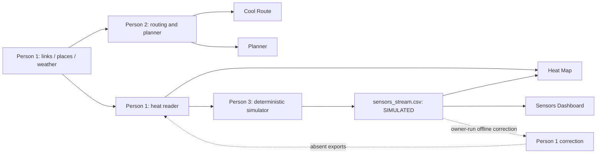

# Phase 7 — team integration audit and QA

> **Historical Phase 7 audit — superseded by the integration repair.** The
> findings and original 162-pass/1-xfail record below are retained for traceability.
> Current fixes, tests, browser evidence and deployment assessment are in
> [full_integration_repair.md](full_integration_repair.md), with recomputed
> [final_results.md](final_results.md). Original inputs remain unchanged; new
> corrected/results artifacts are separately versioned. Deployment is not authorized.

Audit date: **21 October 2026**. Historical status: **PARTIAL**.
The app is a working, explicitly modelled design-day demonstration. A confirmed
place-to-junction integration bug, mixed-date planner radiation and incomplete
sensor-correction integration prevent a fully consistent production claim.

## Scope, ownership and repository safety

Branch: `person3-app-simulator`. At audit start, the uncommitted Phase 6 files
were `app.py`, `README.md`, `planner.py`, `tests/test_planner.py` and
`docs/planner_app.md`. That work was retained. No pull, merge, rebase, commit,
push, deployment, correction pipeline or shared-data generation was performed.

| Owner | Modules / data |
|---|---|
| Person 1 | `heat_model/`; frozen network/places/buildings GeoJSON; `weather.csv`; tags/overrides; heat columns; hottest-link report; future corrected heat and sensor validation |
| Person 2 | `engine.py`, `person2_results.py`, intervention assumptions in `interventions.csv`, saved `priorities.csv`, demand/flow outputs |
| Person 3 | `app.py`, `app_data.py`, `cool_route.py`, `heat_map.py`, `sensors_dashboard.py`, `planner.py`, `simulate_sensors.py`, simulator config, `sensors_stream.csv`, app dependencies and associated tests/docs |
| Shared interface | `sensor_links.csv`: Person 1 supplied the eight locations/link IDs; Person 3 consumes them without changing them |

Protected-file SHA-256 hashes cover `engine.py`, `heat_model/*.py` and every
existing data file. They are checked before and after QA. Test fixtures modify
only copies under pytest's ignored temporary directory. Browser screenshots,
profiles, logs, helpers and the separate clean QA environment remain in ignored
`cache/`; application imports do not depend on them.

## Architecture



The app performs no model regeneration. Each tab's controls run in an independent
Streamlit fragment. All four tabs render initially; later widget interactions
rerun their own tab. Hours are independent by design: route and heat start at
14:00; sensor replay starts at S01 / 13:05; Planner heat-drop output means 13:00.

## Interface compatibility

| Producer | Consumer | Expected contract | Actual contract / evidence | Status | Owner / recommended fix |
|---|---|---|---|---|---|
| Person 1 baseline | Both heat readers | Same link/hour heat and shade | All 13 hours agree exactly; raw heat also reproduces Person 1's design-weather formula after rounding | PASS | Preserve frozen IDs and units |
| Person 1 corrected exports | Heat Map, Route, Planner | One effective heat value per link/hour | No `heat_corr_hXX` or `sensor_validation.csv`; Person 1 reader would prefer corrections, engine ignores them | NOT INTEGRATED | Persons 1/2: implement the common effective-heat contract below |
| `weather.csv` | Heat, simulator, Sensors, route labels | Design day only | 13 design rows dated 2026-09-06; Person 3 validates this bundle and rejects heat/weather drift | PASS | Person 1 supplies matching exports |
| `weather.csv` | Planner calculations | Radiation for the heat baseline's date | Engine averages 13 design and 13 forecast rows dated 2026-10-19 | FAIL | Person 2: filter design day before grouping |
| `places.node_id` | Routing and walking demand | Use authoritative exported junction | Engine ignores node IDs and snaps using incorrectly assigned node coordinates; 53/66 disagree | FAIL | Person 2: honor supplied node IDs; coordinate fallback node geometry with Person 1 |
| Undirected walking geometry | Engine node-coordinate snapping | Do not infer u/v orientation from line order | 907/1,034 IDs receive contradictory endpoint coordinates under the engine's assumption | FAIL | Person 2: correct node coordinate construction; Person 1 can supply authoritative node geometry |
| Intervention guidance | Engine solar delta | Agreed shade-gain interpretation | Guide proposes proportional gain; engine adds gain directly, with different tree/sail settings | NOT INTEGRATED | Persons 1/2 must agree semantics before changing outputs |
| Engine allocation | Planner UI | Positive-benefit selections, one/link, within budget | Real public API, independently summed costs and checked budget; no invented optimizer | PASS | Person 3 retains actual engine outputs |
| Engine benefit fields | App units | Per-trip versus population-weighted exposure | UI uses °C·min per trip and person·°C·min/day for daily planning benefit | PASS | Person 2 should add explicit benefit/heat-drop units and hour metadata |
| Sensor CSV | Heat Map / Sensors | Eight valid sites, timezone-aware synthetic samples | Exactly 1,154 rows, source `simulated`; seed/faults reproduce CSV in memory | PASS | Person 3; add a provenance sidecar in a future coordinated output update |
| `engine.latest_sensors()` | Potential replay consumers | An explicit as-of cutoff for replay | Returns newest readings without a cutoff; Person 3 intentionally uses its validated CSV replay adapters instead | PASS for current app usage | Person 2: document this as latest-only; do not substitute it for replay filtering |
| Sensor CSV | Offline correction | Same design date and validated timestamp/source | Current file is compatible, but correction loader groups by hour without filtering date | NOT INTEGRATED | Person 1: validate date/IDs/timestamps and export provenance |
| Shared data updates | Person 3 caches | Reload or reject stale snapshots | Planner keys include input paths/stat metadata; Heat Map now rejects stale attributes/geometry/baseline and weather mismatch | PASS with limits | Person 1 cached reader still requires restart; immutable manifests remain proposed |

“PASS” for arithmetic or data compatibility does not mean the unresolved routing
and correction algorithms have been repaired. Those remain visible handoff items.

## Verified data and numerical findings

- 1,491 nonempty valid LineStrings, EPSG:4326. Bounds:
  `[101.5648679, 2.9853376, 101.5861823, 3.0066508]`; maps use `[lon, lat]`.
  There are 18 covered links and 868 with canopy greater than zero.
- Heat Map and `engine.heat_at()` agree at every hour 07–19 on the current
  **uncorrected** data. Default-route distance, sun time and exposure reconstruct
  from the same link/hour attributes. The source polylines in both default routes
  meet at their endpoints; individual geometry validity does not validate snapping.
- The heat score is a modelled index with Celsius-labelled values, not measured
  air temperature. The formula is `Tair + (1−shade)×R/1000×(8+4×(1−albedo)) − 0.5×wind`.
  The app checks baseline agreement to 0.00501°C, allowing the export's two-decimal
  rounding; it never substitutes a recomputed value for the exported heat.
- At 13:00, design radiation is 841.3 W/m² but the engine uses 843.7.
  At 14:00, it uses 793.4 instead of 806.0; at 19:00, 14.75 instead of 29.5.
  Changing the app hour does not select forecast heat. The known mixing occurs
  inside intervention calculations, across their hourly solar deltas.
- Planner's `heat_drop` is the **13:00 index reduction**. Its misleadingly named
  `person_min_saved_day` actually sums walkers × walking minutes × reduction in
  degrees above the assumed 32°C comfort line: **person·°C·min/day**. Benefit/RM
  divides that daily exposure saving by RM. It is not a medical outcome.
- The engine uses 72 m/min walking speed and assumed household trips per day:
  transit 0.9, shop 0.45, park 0.15, community 0.10. Current intervention costs are
  trees RM160/m, sail RM350/m, covered walkway RM1,000/m and paving RM120/m.
  These require local validation, not claims of actual quotations.
- The assumptions document still contains “To set / To find” entries for Person
  2's implemented demand/cost assumptions. Person 2 should update those entries.
- Forecast date 2026-10-19 is two days before this audit. It is a saved snapshot,
  not live weather; no refresh was attempted. The design replay is intentionally
  historical. `priorities.csv` is a saved snapshot, not a live app dependency;
  its 14 rows total RM99,584 and 5,561.76496 daily exposure units, matching current
  live totals. There is no provenance manifest proving freshness of every output.
- `flow_day` is null for all links and there are no hourly flow exports. Engine
  demand is recomputed in memory, so the app still operates. Do not imply a saved
  flow export exists or run the writer without coordinating shared-file ownership.

## Confirmed snapping blocker and suggested Person 2 patch

The network was exported after conversion to an undirected graph. LineString
coordinate order can oppose the `(u, v)` property order. `engine._build_graph()`
unconditionally maps the first coordinate to `u`, the last to `v`, then overwrites
node coordinates as more edges are processed. Observed coordinate disagreement
under that assumption reaches **607.50 m**. This is a snapping bug, not an
EPSG:4326 ordering bug or evidence that each drawn line is invalid.

For **P066**, `places.node_id` is **8141631184**; the engine currently resolves
**8010765356**. Other affected places include P001, P002 and P003; 53 of 66 differ.
Walking demand also uses this snapping, so investment benefits need re-baselining
after the fix. Numerical agreement with current engine outputs does not establish
that those outputs use the intended place junctions.

Suggested implementation, **not applied**:

```python
# In Person 2's place resolution, before coordinate fallback:
if pd.notna(place.get("node_id")):
    node = f"node:{int(place['node_id'])}"
    if node not in graph:
        raise ValueError("Place node_id is absent from the walking graph")
    return node
```

Use that common resolver in `route()`, `walking_demand()` and `route_summary()`
for every home/destination. For coordinate fallback, consume authoritative node
coordinates or reconcile geometry orientation explicitly; do not guess first=u.
Person 1 can export a frozen `node_id → Point` dataset if needed without changing
link IDs. Add tests using reversed line orientation and the current station.
Re-run route/demand/planning reference results after the owner-approved change.

## Exact correction and weather handoff

Proposed common contract for Persons 1 and 2:

1. Shared bundle has a single explicit design date, hours 07–19 once each, CRS
   EPSG:4326 and unique frozen link IDs. Both readers resolve the same bundle.
2. `heat_hXX` remains the uncorrected index. `heat_corr_hXX`, when supplied, is
   complete and finite for the entire advertised hour. Never mix corrected and
   baseline rows silently. Missing correction is a labelled baseline fallback;
   incomplete correction is an error.
3. Public readers expose `heat_model` (baseline), `heat` (effective), `shade`,
   `hour`, `design_date`, `heat_source` and `sensor_source`. Engine's `heat_score`
   must equal that effective `heat`. Metadata identifies baseline versus an
   **offline correction using simulated readings**; no measured-field claim.
4. Routing, prioritization and preview must all use effective heat consistently.
   Preview's solar-term delta must preserve any correction already in its baseline.
5. Intervention radiation must come only from the matching design rows. Reject
   duplicates, missing hours, nonfinite radiation or multiple design dates.
6. Person 1 owns producing `heat_corr_h07`–`heat_corr_h19`,
   `sensor_validation.csv` and a small provenance manifest linking the design
   date, heat/weather/sensor/config hashes, correction parameters and source labels.
   Current correction script writes shared files; it must be run by one agreed owner.
7. Correction input filters timezone-aware timestamps to the design date and
   validates sensor/link mappings and finite air readings before hourly grouping.
   The existing nearest-hour rule corresponds to `[hour−30min, hour+30min)`.
   Such centred windows are offline calibration, not causal live replay readings.
8. No valid sensor-hour means no invented observation. The owner must document
   the existing baseline fallback when no correction offset is available.

The correction code shifts the heat index by an **air-minus-design-weather
offset**; it does not replace the index with sensor air temperature. A read-only
call to its loader/offset functions found **104 usable sensor-hours** in current
data. S02 still has a noon median from 11:30–11:55 despite its half-hour outage:
12:00 offset 1.170°C, 13:00 offset 1.608°C. Do not claim the entire noon correction
hour is missing. No correction main function, writer or generated heat output ran.
The loader currently ignores dates, so another day's readings could contaminate
an hour; fix the date filter before generating the coordinated outputs.

## Sensors and status checks

The stream exactly reproduces the configured seed **20260906** after three-decimal
CSV rounding, verified by generating DataFrames in memory without writing them.
All 8 configured sites are present. Every timestamp is on 6 September 2026,
07:00–19:00 inclusive, five-minute steps with `+08:00` / Asia/Kuala_Lumpur.

- S01 at 13:05: **+8°C** to both air and surface versus the same-seed no-fault
  DataFrame. CSV air is 43.738°C, weather air 34.475°C. The causal detector's
  departure is **7.6825°C**, distinct from the configured injection magnitude.
- S02 has 139 readings; the other sites each have 145. Exactly six readings at
  12:00–12:25 are absent; 12:30 is present. At 12:00 it is Stale (age 5 min),
  12:10 Missing (age 15), and 12:30 Active (age 0).
- Dashboard anomaly detection uses a >3°C departure from the previous 30-minute
  air-minus-weather median, requiring three prior readings. Configured faults
  do not drive detection. Full-day history can show future samples but statuses
  and event counts use replay time only.
- Heat Map intentionally withholds samples older than five minutes; Dashboard
  displays labelled stale readings up to ten minutes. This documented tolerance
  difference is not a heat/air substitution. Both reject invalid timestamps.
- Config annotations remain intended settings, not proof of generation provenance.
  Current reproducibility was independently verified, but no sidecar automatically
  guarantees future CSV/config agreement after either is edited.

## Person 3 changes

- Added `app_data.py`: validates one design date, complete hours and finite weather;
  checks heat/weather coherence through Person 1's unchanged formula; detects
  incompatible engine data-directory overrides.
- Heat Map detects stale geometry, shade, canopy, length, surface, coverage, node
  metadata and baseline even if effective heat values happen to stay unchanged.
  It fails with a restart instruction rather than clearing Person 1's global cache.
- Route and Planner validate the source baseline against design weather before
  displaying/calculating results. Route date comes from validated data and its
  uncorrected baseline is explicit. Corrected Heat Map, if later supplied, warns
  that routing/planning still use baseline until Person 2 integrates corrections.
- A mismatched engine directory disables Route and Planner and reports the issue;
  Heat Map/Sensors remain available. Missing-place error behavior is preserved.
- Dashboard validates fault configuration before creating annotations. Invalid
  configuration generates a warning and omits annotations; real CSV detection
  continues independently. Heat Map rejects naive, duplicate and off-grid samples.
- Four independent Streamlit fragments prevent unrelated tab rerenders. Budget
  and preview caches still call the actual public engine functions, keyed by input
  paths, modification nanoseconds and sizes; they return copies and write nothing.
  No formula, ranking, cost, demand or routing algorithm was changed.

## Performance evidence

Read-only `cProfile` of `engine.priorities(100000)`:

| Measurement | Observed |
|---|---:|
| Total with profiler overhead | 19.924 s; 29.8 million calls |
| `walking_demand()` | 10.313 s |
| Snap calls | 1,122; 4.563 s cumulative |
| Distance evaluations during snapping | 1,160,148 |
| Shortest-path calls during demand | 1,088; 4.158 s cumulative |
| Link/fix evaluations | 5,964; 5.042 s cumulative |

Prior standalone unprofiled calculation was about ten seconds; these timings
are not a controlled before/after benchmark. New budgets still require the real
engine's computation. Person 3's safe improvement avoids rerouting/redrawing all
other tabs during a Planner interaction. Browser QA checks unrelated map canvas
identity and reports end-to-end budget timings separately.

Person 2 can consider input-keyed demand reuse and repeated destination-snap
reuse after resolving the authoritative node-ID bug. Those changes require
equivalence tests and owner approval; none were implemented in the app.

## Test and browser verification

Run from the repository root:

```powershell
.venv\Scripts\python.exe -B -m pytest tests -q -p no:cacheprovider --basetemp=.pytest_coolcorridor_temp
.venv\Scripts\python.exe -B -m streamlit run app.py --server.address=127.0.0.1 --server.port=8501 --browser.gatherUsageStats=false
```

The original 134 cases remain in the suite. New integration tests reconstruct
route metrics, compare all heat hours, demonstrate correction/radiation gaps,
exercise source-change rejection and cache invalidation on copied files, verify
sensor reproducibility/faults, and test invalid configuration and directory isolation.
The station-node correctness test is an explicit **strict expected failure** for
Person 2's unresolved bug. An XPASS after the owner fixes it requires removing
that marker; it is not a passing integration claim.

Clean environment: created an independent venv under ignored
`cache/phase7-clean-venv`, installed the unchanged pinned lock file successfully,
passed `pip check` and imported all app modules. It does not use system-site
packages. No extra deployment dependencies were added. Browser results and final
test totals are recorded after completion below.

### Final automated run

**162 passed, 1 xfailed in 96.75 seconds**, using the exact full-suite command.
All original **134 tests passed**. There are 28 additional passing integration
cases and one strict expected failure for the station-node bug. No previous test
was removed or weakened. The first full run exposed a Person 3 guard regression
that bypassed the missing-places error; it was fixed before this final run.
Windows required the owning account to reset the existing named pytest temporary
directory; that permission issue was not treated as an application test pass.
The last two cases explicitly reject invalid and `NaT` design dates.

### Browser QA record

**Edge, isolated clean environment:** completed the actual 14:00 and 07:00 Heat
Maps, default 14:00 route display, S01 at 13:05, S02 Missing at 12:10 and Active at
12:30 with the visible full-day gap, budgets RM0 / RM10,000 / RM100,000, real
single-link preview, tooltips and repeated four-tab navigation. Screenshots were
inspected. No page exceptions were reported; CARTO returned HTTP 200. All three
unrelated map canvases remained connected across Planner updates.

Measured Edge end-to-end budget interaction times, including UI settling:
RM0 **57.229 s**, RM10,000 **62.000 s**, cached return to RM100,000 **4.202 s**.
These are browser observations, not engine-only timings. The extra overhead
relative to standalone profiling has not been fully isolated; new calculations
remain slow. Do not claim the fragment change solved core computation cost.

**Chrome, working environment:** the same full matrix completed successfully:
both heat hours, route display, S01 anomaly, S02 outage/recovery, all three budgets,
hover, preview and repeated tab navigation. No page exceptions; CARTO HTTP 200.
Its unrelated map canvases also stayed connected during budget updates. Measured
times were **95.014 s**, **87.820 s** and **3.615 s** respectively. Chrome's 07:00
map, outage chart and preview chart screenshots were inspected, alongside Edge's
heat/fault/preview screenshots. These are actual desktop-size headless browser
checks with software WebGL, not a manual mobile or production-load test.

Protected source/data hashes matched after all browser scenarios. Browser checks
verify displayed engine output and UI stability; they do not resolve the known
incorrect place-junction binding. Local screenshots use `cache/integration-edge-*`
and `cache/integration-chrome-*`, alongside the ignored helper/logs/profiles.

## Deployment readiness checklist and handoff

- [x] Four working local tabs and real repository inputs; no placeholder routes,
  coordinates, readings, costs or intervention benefits.
- [x] Literal pydeck units, bounded sizes, CARTO and EPSG:4326 preserved.
- [x] Synthetic measurements and modelled benefits labelled; correct exposure units.
- [x] Read-only simulations; protected files hashed; working tree preserved.
- [x] Pinned dependencies install in an isolated environment; no literal personal
  Windows paths or credentials found in runtime source/requirements by static scan.
- [ ] **Person 2, critical:** use exported node IDs consistently for routes, demand
  and summaries; repair coordinate fallback and re-baseline affected results.
- [ ] **Person 2, critical:** select matching design radiation; add date/hour/heat
  source/unit metadata and correct misleading corrected-heat docstrings.
- [ ] **Persons 1/2:** agree additive versus proportional shade gain and update
  the shared guidance/assumptions with actual chosen values.
- [ ] **Person 1:** validate correction dates/provenance; coordinate one controlled
  generation and delivery of complete corrections and validation outputs.
- [ ] **Person 2:** consume corrected heat consistently once Person 1 exports it.
- [ ] **Person 3 after owner changes:** rerun cross-tab tests, re-baseline approved
  numerical fixtures, remove resolved expected-failure marker and repeat browser QA.
- [ ] **Team/user:** approve deployment scope and remaining modelling assumptions.

The local **uncorrected demonstration can be reviewed**, with these limitations
disclosed. It must not be presented as a fully integrated corrected-heat system
or a validated real-world investment recommendation. Phase 8 was not started.
